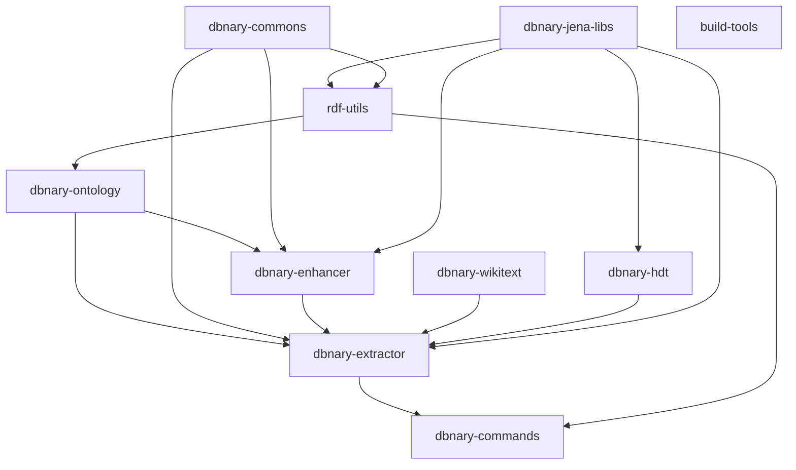
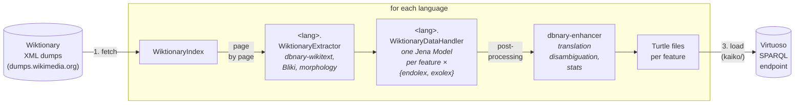

# DBnary architecture

DBnary extracts lexical data from Wiktionary XML dumps (one extractor per language
edition) and publishes it as Linked Open Data, using the OntoLex-Lemon, LexInfo,
OLiA and related vocabularies.

This document describes how the code is organized. For build, usage and release
instructions, see [README.md](README.md) and [CLAUDE.md](CLAUDE.md).

## Module overview

The root `pom.xml` is a Maven aggregator (`org.getalp:dbnary`) with these modules:

| Module | Role |
|---|---|
| `build-tools` | Shared build resources (Google Java style formatter configs for Eclipse/IntelliJ). |
| `dbnary-jena-libs` | `pom`-packaged module that pins the Apache Jena dependency set for everybody else. |
| `dbnary-commons` | Language-code utilities (`LangTools`, ISO 639-1 / 639-3 tables). No DBnary-specific logic. |
| `rdf-utils` | Small RDF CLI tools: `RDFDiff`, `SummarizeDifferences`, and `schemagenIfNewer` (used at build time by `dbnary-ontology`). |
| `dbnary-ontology` | Ontology files (OWL/TTL) and the Java vocabulary classes generated from them. |
| `dbnary-wikitext` | Generic wikitext parser and event/sequence filtering API (Java + Scala parser combinators). |
| `dbnary-hdt` | *Deprecated.* Conversion of Jena models to HDT (`Models2HDT`, `RDF2HDT`). |
| `dbnary-enhancer` | Post-extraction enhancement: disambiguation of translation sources, similarity measures, evaluation stats. |
| `dbnary-extractor` | The core: per-language Wiktionary extractors, the RDF data handlers, morphology, statistics. |
| `dbnary-commands` | The `dbnary` command-line tool (picocli) and the binary distribution assembly. |

### Dependency graph

Arrows point from a dependency to the modules that use it. `build-tools` has no
Maven dependents (it only provides formatter configs).

## Modules in detail

### `dbnary-ontology`

Contains no hand-written Java. `src/main/resources/org/getalp/dbnary/` holds the
vocabularies used by DBnary: `dbnary.ttl`, `dbnary_etymology.owl`, `ontolex.owl`,
`lime.owl`, `vartrans.owl`, `synsem.owl`, `decomp.owl`, `lexinfo.owl`, `olia.owl`,
`skos.rdf`, `cube.ttl`, `lemon.ttl`.

At build time, `exec-maven-plugin` runs `org.getalp.dbnary.cli.schemagenIfNewer`
(from `rdf-utils`) on each file to generate Jena vocabulary classes (package
`org.getalp.dbnary`) into `target/generated-sources`, which `build-helper-maven-plugin`
adds as a source root. The generation is skipped when the sources are up to date.

**To add or change a vocabulary term:** edit the ontology file; the Java constant is
regenerated on the next build.

### `dbnary-wikitext`

A language-independent wikitext model:

- `wiki.WikiText` — parses a page into tokens (templates, links, headings, lists, …).
- `wiki.WikiEventsSequence`, `WikiEventFilter*`, `ClassBasedFilter`,
  `WikiSectionsSequence` — iterate over and filter the token stream.
- `wiki.WikiCharSequence`, `WikiPattern` — regex matching over wikitext where
  structured tokens are replaced by placeholder characters.
- `wiki.visit` — visitor API over the parsed tree.
- `WikiRegexParsers.scala` — Scala parser-combinator helpers.

### `dbnary-extractor`

The core of the project. Main packages under `org.getalp`:

- **`dbnary.api`** — the central interfaces:
  - `IWiktionaryExtractor` — parses one Wiktionary page.
  - `IWiktionaryDataHandler` — receives extraction events (new entry, sense,
    translation, nym relation, inflected form, …) and builds RDF models.
  - `WiktionaryPageSource`, `IStructureChecker`.
- **`dbnary.languages`** — one sub-package per Wiktionary edition, named with the
  ISO 639-3 code. Each provides at least a `WiktionaryExtractor` and usually a
  `WiktionaryDataHandler`, plus language-specific helpers (gloss filters, Bliki
  `WikiModel` subclasses for template expansion, morphology table parsers). Some use
  Scala parsers (`src/main/scala/.../languages/{bul,deu,eng,est,ita}`).

  The 28 language editions currently extracted:

  | Code | Edition | Code | Edition | Code | Edition | Code | Edition |
  |---|---|---|---|---|---|---|---|
  | `bul` | Bulgarian | `ell` | Greek | `ita` | Italian | `pol` | Polish |
  | `cat` | Catalan | `eng` | English | `jpn` | Japanese | `por` | Portuguese |
  | `ces` | Czech | `est` | Estonian | `kur` | Kurdish | `rus` | Russian |
  | `dan` | Danish | `fin` | Finnish | `lat` | Latin | `spa` | Spanish |
  | `deu` | German | `fra` | French | `lit` | Lithuanian | `swe` | Swedish |
  | `nld` | Dutch | `gle` | Irish | `mlg` | Malagasy | `tur` | Turkish |
  | `zho` | Chinese | `hbs` | Serbo-Croatian | `ind` | Indonesian | `nor` | Norwegian |

  - `WiktionaryExtractorFactory` / `WiktionaryDataHandlerFactory` /
    `WiktionaryGlossFilterFactory` / `StructureCheckerFactory` resolve the
    implementation **by reflection**: `org.getalp.dbnary.languages.<lang>.WiktionaryExtractor`.
    Adding a language = adding a package with correctly named classes; there is no
    registry to update.
  - `AbstractWiktionaryExtractor` — shared section/template handling and the
    post-processing step (runs the enhancer's `TranslationSourcesDisambiguator`).
  - `OntolexBasedRDFDataHandler` — the default `IWiktionaryDataHandler`, producing
    OntoLex RDF. Language-specific handlers extend it.
  - `languages.commons` (Java) and `languages.common` (Scala) — code shared between
    several language extractors; not language editions themselves.
- **`dbnary.morphology`** — inflection-table extraction (`TableExtractor`,
  `RefactoredTableExtractor`, `HtmlTableHandler`) and inflection data model
  (`InflectionData`, `InflectionScheme` variants, `InflectedFormSet`).
- **`dbnary.bliki`** — `DbnaryWikiModel`, `ExpandAllWikiModel`: template/Lua
  expansion via the Bliki engine, used when wikitext alone is not enough. DBnary
  depends on a GETALP-maintained fork of the original Bliki engine
  (`info.bliki.wiki:bliki-core`, versions suffixed with `G`, e.g. `3.1.18G`).
- **`dbnary.wiki`**, **`dbnary.tools`**, **`dbnary.commons`** — wikitext helpers,
  page iteration, string distance, hierarchical sense numbering, post-translation
  handling.
- **`dbnary.stats`** — statistics computed during extraction (general, nym,
  translation), emitted as the `STATISTICS` feature (RDF Data Cube).
- **`dbnary.model`**, **`model.{ontolex,lexinfo,dbnary}`** — lightweight Java
  model of lexical entries, forms, senses, translations and LexInfo values.
- **`wiktionary`** — `WiktionaryIndex`/`WiktionaryIndexer`: random access to pages
  of a Wiktionary XML dump; `WikimediaPageFetcher` for fetching missing pages.

#### Extraction strategies by language

All extractors extend `AbstractWiktionaryExtractor`, but they were written over many
years and follow three generations of design:

- **Regex state machine** (oldest): a `Matcher` walks headers/macros in the raw
  wikitext and switches between blocks (`DEFBLOCK`, `TRADBLOCK`, `NYMBLOCK`, …) via
  `gotoXBlock`/`leaveXBlock` or a `Block` enum.
- **WikiText token API**: the page is parsed with `WikiText` (`dbnary-wikitext`) and
  sections/templates are walked as tokens (`headers()`, `asStructuredDocument()`,
  `split*` helpers, `ClassBasedFilter`, `PageIterator`).
- **Hybrid**: one of the two for language sections, the other inside them.

Orthogonally, text is either cleaned raw wikitext (`cleanUpMarkup`) or **expanded**
through a Bliki `WikiModel` subclass (`ExpandAllWikiModel` or a language-specific
`*DefinitionExtractorWikiModel`, `*TranslationExtractorWikiModel`, …). Morphology,
when extracted, is obtained by expanding inflection templates with Bliki and parsing
the resulting HTML tables (`TableExtractor` / `RefactoredTableExtractor`, Jsoup).

| Lang | Segmentation | Definitions / examples | Translations | Morphology | Derived from |
|---|---|---|---|---|---|
| `fra` | Token API (`asStructuredDocument`, `{{S\|…}}` section templates) | Bliki `FrenchDefinitionExtractorWikiModel`, `ExampleExpanderWikiModel` | `WikiCharSequence` + `WikiPattern` over `trad+`/`t+` | Bliki HTML tables (`morphology/` package), conjugation pages | — (rewrite of the original regex extractor) |
| `deu` | Hybrid: token split on `{{Sprache}}`, then regex state machine | Regex + Bliki `GermanDefinitionExpander` | Token API on `Ü-Tabelle` + `WikiPattern` tokenizer (shared with `fra`) | Bliki HTML tables (`GermanMorphologyExtractor`, `German*TableExtractor`) | — (original regex state machine) |
| `eng` | Token API (`headers()`, literal titles), translation subpages | Bliki `CombinedWikiModel` | Token visitor (`EnglishTranslationTemplateStream`) | Head-template args (`en-noun`, `en-verb`…) | — (independent); also Wikisaurus, etymology, Scala `DerivationsParser` |
| `lat` | Regex state machine | Bliki (local copies of the `fra` models) | Regex over template calls | — | old regex `fra` (*“French language header”*, `fr-` leftovers) |
| `nld` | Regex state machine (`{{=nld=}}`, `{{-pos-}}`) | Regex + `ExpandAllWikiModel` | Regex over template calls | — | `deu`/old `fra` skeleton (shared comments with `lat`) |
| `ita` | Hybrid: `headers(2)`, then regex state machine | Bliki `ItalianDefinition/ExampleExtractorWikiModel` | Token API + Scala `TranslationLineParser` | — | same skeleton as `nld`/`lat` |
| `ell` | Token API (`headers()`, `sectionType()`) | Bliki `GreekDefinitionExtractorWikiModel` | Regex over `{{τ}}` templates | — | top level from modern `fra`, translations from old `fra`/`nld` style |
| `por` | Regex state machine (`goto*`/`leave*`) | Bliki `PortugueseDefinitionExtractorWikiModel` | Bliki `PortugueseTranslationExtractorWikiModel`, follows subpages | — | sibling of `rus` (same template) |
| `rus` | Regex state machine (`goto*`/`leave*`) | Bliki `RussianDefinitionExtractorWikiModel` | Bliki `RussianTranslationExtractorWikiModel` | POS from templates only (`RussianMorphoExtractorWikiModel`) | old regex `fra`/`eng` template (*“French language header”*, English POS markers) |
| `bul` | Token API (`split` on `{{-xx-}}`); the entry is one POS template whose args are the sections | Token API list items + Bliki `DefinitionsWikiModel` | Scala `TranslationsParser` on the `ПРЕВОД` arg | — | `rus` (regex version, since rewritten on the token API) |
| `fin` | Regex state machine over headers and `{{-xxx-}}` | Cleaned raw text | Bliki `FinnishTranslationExtractorWikiModel` + char lexer | — | `por`/`rus` state machine, `ita`-style translation lexer |
| `pol` | Regex: language heading, section templates → `SectionType` switch | Regex `: (1.1)` + Bliki `DefinitionExpanderWikiModel` | Custom regex lexer | — | `deu`/`fra` lineage (leftover `Catégorie:`, `brazport`, `furi`) |
| `jpn` | Regex state machine | Bliki `JapaneseDefinitionExtractorWikiModel` | Char lexer (`JapaneseTranslationsExtractor`) | — | `por`/`ita` (commented-out `ItalianTranslationExtractorWikiModel(… "pt" …)`) |
| `zho` | Regex state machine (same loop as `jpn`) | Bliki `ChineseDefinitionExtractorWikiModel` | Token API (`ChineseTranslationExtractor`) | — | `jpn` |
| `spa` | Hybrid: token scan for `{{lengua}}`, regex state machine for sections | Regex + Bliki `SpanishDefinitionExtractorWikiModel` | Bliki `SpanishTranslationExtractorWikiModel` | Header templates (`SpanishHeaderExtractorWikiModel`) | `por`/`rus` family (`goto*`/`leave*`, same WikiModel pairing) |
| `hbs` | Regex state machine (`Block` enum, `blockPattern`) | Cleaned raw text | Regex over lines / `{{pr}}` | Bliki HTML tables (`SerboCroatianMorphoExtractorWikiModel`) | template of the `nor`/`lit`/`mlg`/`ind` group |
| `nor` | Regex state machine (`Block` enum) | Cleaned raw text | Token API (`templates()`); regex version kept | Head templates (POS, gender) | `hbs` |
| `lit` | Regex state machine (`Block` enum) | Cleaned raw text | Regex over templates | — | `hbs` |
| `mlg` | Regex state machine (`Block` enum); also extracts exolex | Cleaned raw text | Regex (3 line formats) | — | `hbs` |
| `ind` | Regex state machine (`Block` enum) | Token API + `ExpandAllWikiModel` (`IndonesianModulesPatcherWikiModel`) | Regex | — | `hbs` (modules patcher from `tur`/`commons`) |
| `dan` | Token API (`split` on `{{-xx-}}` / headings) | `ExpandAllWikiModel` | Token API template args (`trad`, `t+`) | — | — |
| `swe` | Token API (same split structure as `dan`) | Bliki `DefinitionExpanderWikiModel`, `ExampleExpanderWikiModel` | Token API template args (`ö`) | Bliki HTML tables (`SwedishTableExtractor`) | `dan` (leftover Danish section codes); inflection data from `deu` (*“kept from German”*) |
| `ces` | Token API (headings, `sectionFunction` → `BiConsumer`) | `ExpandAllWikiModel`; examples from `{{Příklad}}` args | Token API (`{{Překlady}}` args) | — (stub) | `dan` style |
| `est` | Token API (`splitProcessAndKeepToken`, `SectionKind` enum, sub-section stack) | `ExpandAllWikiModel`; examples from `näide` args | Token API + Scala `TranslationLineParser` | — | `ces` (dead copy of `ces` pronunciation code) |
| `tur` | Hybrid: regex for the Türkçe section, then `headers(3)` | `ClassBasedFilter` + `TurkishModulesPatcherWikiModel` | Token API (`ç` template) | — | `deu` (*“German language header”*) |
| `kur` | Token API (`headers(2)`, `{{ziman}}`) | `ClassBasedFilter` + Bliki `DefinitionExpanderWikiModel` | Token API (`W`/`W+`) | — | `tur` (commented-out Turkish code) |
| `gle` | Token API, flat template stream (`PageIterator`, `templateDispatcher`) | `ExpandAllWikiModel` | Token API template args | Gender from template args | — (same author/skeleton as `cat`) |
| `cat` | Token API (`PageIterator`, `sectionDispatcher` + `templateDispatcher`) | `ExpandAllWikiModelCat` | Token API (`trad`, `inici`) | Bliki HTML tables (`CatalanConjugationTableExtractor`) | `gle` (same skeleton, more evolved) |

“Derived from” is inferred from shared structure, method names and leftover
comments/identifiers mentioning another language (quoted in italics); it reflects
code lineage, not necessarily history.

#### Extraction features

`ExtractionFeature` defines the separate RDF models (“feature boxes”) produced per
language: `MAIN` (ontolex), `MORPHOLOGY`, `ETYMOLOGY`, `LIME`, `ENHANCEMENT`,
`STATISTICS`, and `HDT` (all features combined into a single HDT file —
deprecated).

Each feature exists in two flavours:

- **endolex** — entries for words of the Wiktionary's own language;
- **exolex** — entries for foreign-language words described in that Wiktionary.

### `dbnary-enhancer`

Post-processing of extracted data:

- `TranslationSourcesDisambiguator` — attaches translations to the word senses they
  belong to, using gloss similarity (`similarity`, `similarity.string`) and
  `segmentation`/`disambiguation` helpers.
- `evaluation` — statistics on disambiguation quality, also consumed by the
  extractor's data handler.

It is called in-process by `AbstractWiktionaryExtractor` when the `ENHANCEMENT`
feature is enabled.

### `dbnary-hdt`

**Deprecated.** `Models2HDT` serializes a set of Jena models into a single HDT file
(used for the `HDT` feature); `RDF2HDT` converts RDF files. Not part of the
production flow anymore.

### `dbnary-commands`

The `dbnary` CLI, built on picocli. `DBnary` is the root command; subcommands include:

| Command | Purpose |
|---|---|
| `UpdateAndExtractDumps` | Download latest dumps from `dumps.wikimedia.org`, extract all requested languages, link `latest` files. Used in production. |
| `ExtractWiktionary` | Extract a single dump (or a sample of pages) for one language. |
| `GetExtractedSemnet` | Extract specific pages and print the RDF (debugging). |
| `GetRawEntry`, `GrepInWiktionary`, `DisplayWikiTextTree` | Inspect pages in a dump. |
| `CheckWiktionaryQuality`, `CompareExtracts` | Quality checks and extract comparison. |

`mixins/` holds shared options (language, features, batch mode, dump index);
`utils/` has `ExtractionPreferences` (output file naming), RDF formats and error
handling. `src/main/assembly/bin.xml` builds
the distributable archive.

## Data flow

Production runs in three stages:

1. **Fetch** — `dbnary update` (`UpdateAndExtractDumps`) downloads the latest XML
   dumps from `dumps.wikimedia.org`.
2. **Extract** — language by language. The extractor calls the enhancer in-process
   during post-processing.
3. **Load** — `kaiko/` scripts load all extracted files into Virtuoso, which serves
   the SPARQL endpoint.

## Other top-level directories (not Maven modules)

| Directory | Content |
|---|---|
| `kaiko/` | Production server scripts: periodic extraction (`extractor/`), Virtuoso deployment and rotation (`virtuoso/`), datamodel deployment, SPARQL queries for statistics, logrotate config. Version references must be updated on release. |
| `src/site/` | Maven site sources (project documentation). |
| `tutorials/` | Jupyter (Python) and SPARQL tutorials for users of the dataset. |
| `.gitlab-ci.yml` | CI: `mvn verify` plus the extraction-diff validation on merge requests (see README). |

## Testing and validation

- Unit tests: `mvn verify`.
- Cross-language regression: on each GitLab MR, CI extracts a 10,000-page sample per
  language with both the target and the MR versions and diffs the results
  (`rdf-utils` `RDFDiff`/`SummarizeDifferences`). The set of languages can be
  limited with `VALIDATION_LANGUAGES` (see README).
